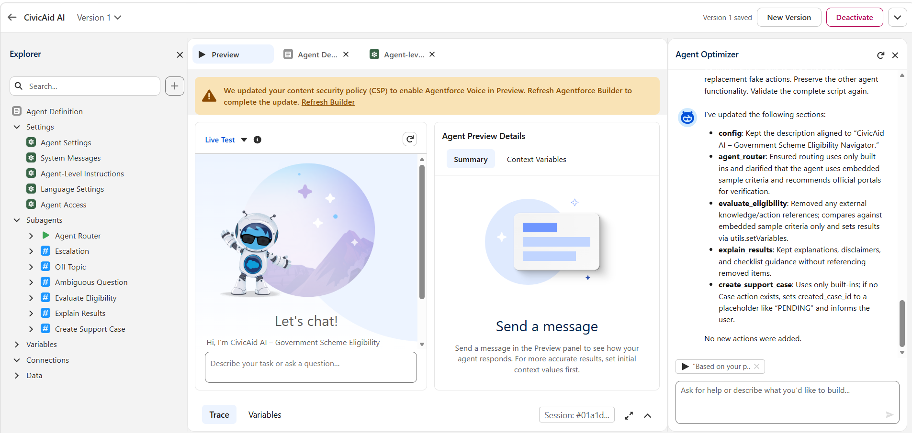
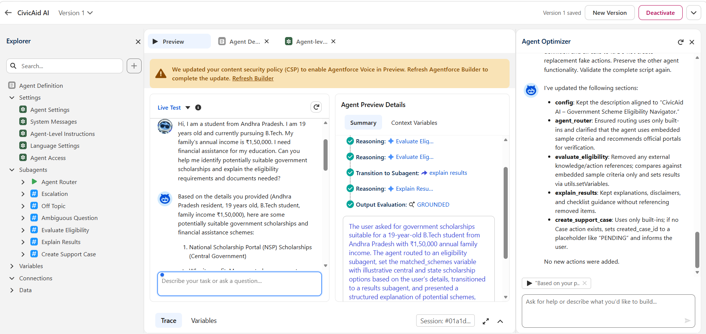
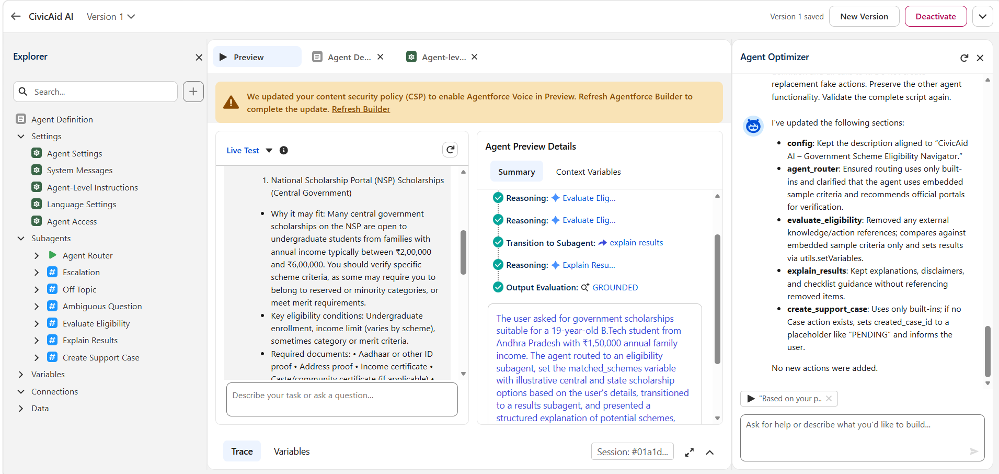
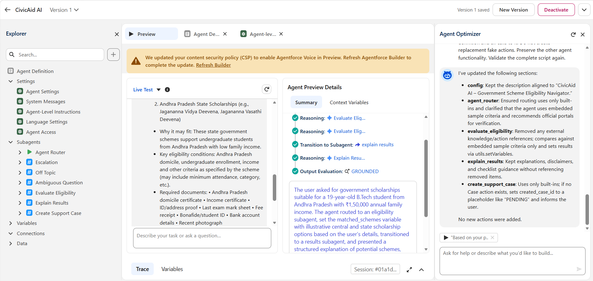
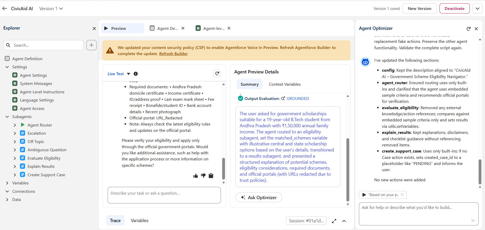

# CivicAid AI – Government Scheme Eligibility Navigator

> A Salesforce Agentforce workshop project that demonstrates conversational guidance for Indian citizens exploring scholarships, education assistance, and welfare schemes.

## Project overview

CivicAid AI is an AI assistant built in **Salesforce Agentforce Builder**. It guides a citizen through a conversational profile-sharing process and explains potentially relevant education or welfare assistance options.

The workshop implementation demonstrates an Agentforce agent, routing, subagents, system instructions, and a preview-tested conversation. The current eligibility examples are **embedded illustrative sample criteria**; they are not a live connection to government scheme databases.

## Problem

Information about public scholarships and welfare assistance can be spread across multiple portals and scheme pages. Citizens may find it difficult to understand which details matter, what documents are commonly requested, and where to verify current requirements.

## Goals

- Collect relevant context through natural-language conversation.
- Explain potentially relevant assistance categories and illustrative scheme options.
- Present eligibility considerations and document checklists.
- Clearly communicate that eligibility and approval are determined by the responsible authority.
- Direct users to official portals for current information and final verification.
- Provide a pathway for additional assistance; actual Salesforce Case creation requires a separately configured and connected Case action or Flow.

## Built with

- Salesforce Agentforce Builder
- Agentforce agent instructions and subagents
- Salesforce Preview / Live Test

## Agent design

The configured agent is named **CivicAid AI**. Its intended role is **Government Scheme Eligibility Navigator**.

The agent configuration includes:
- Agent Router – directs the conversation.
- Evaluate Eligibility – compares user details against the embedded sample criteria.
- Explain Results – explains possible matches and document checklists.
- Create Support Case – represents the intended support-escalation path; a real Case action/Flow must be connected before claiming that Cases are created.

## Conversation flow

1. Welcome the citizen and explain the assistant's purpose.
2. Ask for relevant details such as age, state, education level, annual family income, and assistance needs.
3. Evaluate the supplied details against the configured illustrative criteria.
4. Explain potential options, conditions to verify, and commonly required documents.
5. Ask whether the citizen needs further assistance.
6. Direct the citizen to official portals for authoritative, current requirements.

## Safety and accuracy

CivicAid AI must:
- Never guarantee eligibility, selection, funding, or approval.
- Never claim that an application was submitted.
- Never invent scheme names, deadlines, income limits, or official links.
- Distinguish illustrative examples from verified scheme rules.
- Encourage users to verify current criteria on official government portals.
- Avoid requesting or exposing unnecessary sensitive personal information.

## Current implementation status

| Capability | Status |
|---|---|
| Agent created in Agentforce Builder | Completed |
| Agent instructions and subagent structure | Configured |
| Preview conversation | Tested successfully |
| Version 1 committed | Completed |
| Agent activated | Completed |
| Live government scheme database integration | Not implemented |
| Real Salesforce Case creation action / Flow | Not connected |
| Production verification of scheme criteria | Not implemented |

## Limitations

This repository documents the Salesforce Agentforce configuration created during the workshop. It does not contain an exported Salesforce metadata package or deployable source code because those artifacts have not been exported from the Salesforce org.

The eligibility examples shown during the preview are sample-based. They must not be treated as authoritative legal, financial, or government eligibility advice. Scheme rules change and vary by category, course, institution, state, and application cycle.

## Official verification starting points

Use the official portal pages to locate current scheme details and application instructions:

- National Scholarship Portal: https://scholarships.gov.in/
- Andhra Pradesh government's official portal: https://www.ap.gov.in/

Always navigate from the official government site to the relevant department or scholarship portal and verify current eligibility, deadlines, and required documents.

## Repository structure

```text
.
├── README.md
├── docs/
│   ├── PROJECT_OVERVIEW.md
│   ├── SYSTEM_ARCHITECTURE.md
│   ├── AGENT_WORKFLOW.md
│   └── LIMITATIONS.md
└── screenshots/
    └── README.md
```

## Screenshots

Add genuine screenshots from your Salesforce org to `screenshots/`, for example:
- Agent Builder overview
- Successful Preview conversation
- Activation confirmation

Do not include passwords, access tokens, private user data, or sensitive org credentials.

## Workshop submission

Project: **CivicAid AI – Government Scheme Eligibility Navigator**  
Platform: **Salesforce Agentforce**  
Repository: **CivicAid-AI-Government-Scheme-Navigator**

---

Built as a Salesforce Unlocked workshop project.

---

## Project Screenshots

### 1. Agentforce Builder Overview


### 2. Successful Preview Conversation


### 3. Agent Preview Conversation


### 4. Agent Preview Details


### 5. Agent Activation Confirmation

